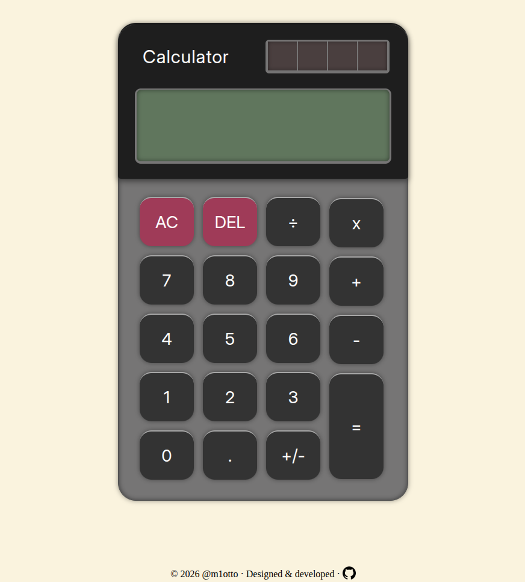
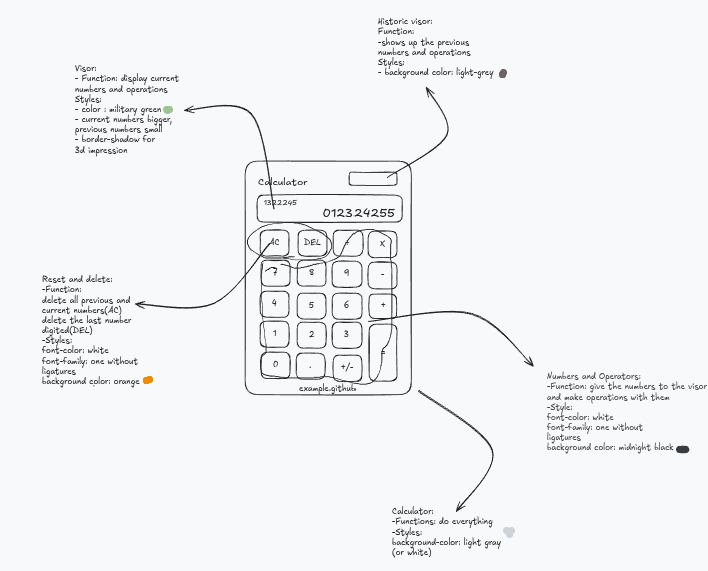

# Calculator

An functional browser calculator designed specially by me.

The project concept it's a simple and functional calculator, with basic operations, decimal, interactive display and much more!

## Preview

**[Live Demo](https://m1ott0.github.io/the_odin_project/projects/calculator/)**



## About

The project do basic operations with two numbers and an operator(like '+'), you can use it by clicking on the number that you want, then using decimal or change signal buttons(if you want), an operator, and finally the last number, and at the end, you will see the result at the bottom of the display, and the record of the operation at the top of it. If the result exceed the number of 15 characteres, it will popup a 'SYNTAX ERROR' on the screen, and you will just have to press any button to come back to reset it.

## Features

- AC(reset) button
- DEL(delete) button
- Equal button
- Change signal button
- Decimal button
- Record display
- Operations Display


## Technologies Used

- HTML5
- CSS3
- JavaScript

## Getting Started

### Prerequisites

- A modern web browser.
- Git (optional).

### Installation

1. Clone the repository:

   ```bash
   git clone https://github.com/m1ott0/the_odin_project.git
   ```

2. Navigate to the project directory:

   ```bash
   cd the_odin_project/projects/calculator
   ```

3. Open `index.html` in your browser.

## How to Use

1. Select a number
2. Use decimal or change signal buttons (if you want)
3. Select an Operator
4. Select another number
5. Use decimal or change signal buttons (if you want)
6. Press the Equal button
7. Vizualize the result and do more operations with him or just click the AC(reset button) to reset the operation

## Project Structure

```
calculator/
├── index.html
├── style.css
├── script.js
├── fonts/
│       ├── calculator.ttf
├── images/
│       ├── github.png
├── sounds/
│       ├── click.wav
├── screenshots/
│       ├── initial-prototype.png
│       └── final-preview.png
└── README.md
```

## Design Process

### Initial Prototype



The core of my Initial Prototype was to do a simple white calculator structure with orange and gray buttons, but after some time on the project, i've change my mind and decided to implement a more complex calculator design with black display and title backgrounds, gray structure,  dark-gray and pink buttons, and a solar panel based on some cientific calculators that has it. ate the start, the solar panel was containing the record of the operations, but then, i've turned him into a separate fancy feature, and put the record above the main display. And the last thing i've changed in the design is the position of the credits view, puting him into the bottom of the page. 

## What I Learned

- DOM manipulation
- Use functions more eficiently
- Import font and sounds easily
- Flexbox and css animations
- How a calculator works

## Author

**Felipe Miotto**

- [GitHub Profile](https://github.com/m1ott0)

## Acknowledgments

- [The Odin Project](https://www.theodinproject.com/)